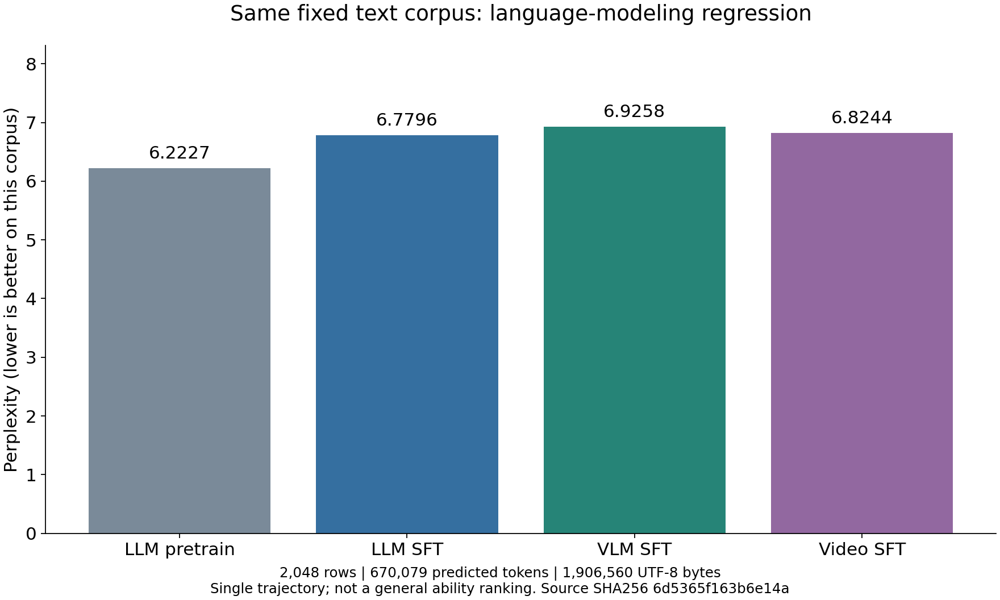
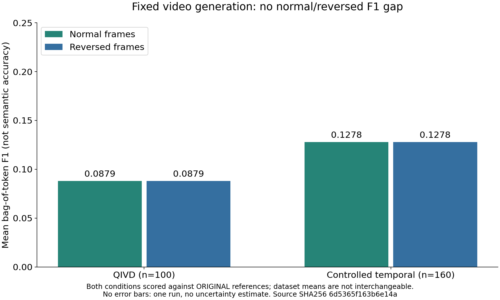

# MiniMind 三模型 CUDA 复现：综合学习报告

本次完成了随机初始化语言主干的预训练、语言SFT、图像两阶段、视频两阶段及固定评估。
工程链路已闭环，但本次结果**不支持可靠指令遵循、稳定图像理解或有效时序推理已经建立**。
这份GitHub报告解释设计、实现、实际运行和结果边界，不以训练完成代替项目最终验收。
[最终证据审计](cuda-final-evidence-audit.md)逐项列出已查证材料、来源限制、测试设备偏差及文件交付范围。

后续追加的[各100条实际推理诊断](three-task-100-diagnostic-20261025.md)使用相同最终权重，
文本/图片/视频单一AI复核分别判为34/4/25条正确，并保留无法判定项、全部原文和本地输入展示。
这不是训练改善或外部基准结果，不与原固定评估混作一次执行。

## 1. 研究路线：共用语言核心，分别扩展模态

本项目是fixed-budget教学复现，不是上游完整训练预算或全部功能的逐项复刻。
LLM接收文本并生成文本；VLM接收图像与问题并生成文本；Video-Omni接收视频与问题并生成文本。
这里的Omni不包含音频输入、语音生成或任意模态输出；冻结的SigLIP2和Tokenizer均是复用资产。

```text
随机初始化语言核心 → LLM Pretrain → LLM SFT
                                     ├─ 新图像Projector → VLM Alignment → VLM SFT
                                     └─ 新时序Adapter/Projector → Video Alignment → Video SFT
```

视频模型不继承VLM SFT。新增模块随机初始化不等于整个多模态模型从零训练。
[A01–A04设计图](figures/minimind-architecture/README.md)展示权重关系、数据流和冻结范围；
这些是设计示意，不是运行截图，也不因架构存在就证明能力出现。

| 对象 | 实际结构与接口 | 学习重点 |
|---|---|---|
| LLM | 63,912,192独立参数；8层、hidden768、8Q/4KV头、SwiGLU2432、词表6400 | causal attention、下一token预测、共享Embedding/LM Head |
| VLM | 256×256图像→冻结SigLIP2的64×768特征→Projector→64个语言视觉位置 | 表示对齐、early fusion、槽位数量与顺序 |
| Video | 8帧→每帧64个patch→空间query池化→帧位置＋2层时序Transformer→16个query向量 | 时序表示、压缩、帧序消融、语言先验捷径 |

语言Block使用RMSNorm、RoPE与GQA；本实现通过重复K/V头调用SDPA，不声称使用专门优化的GQA内核。
生成逐token重算上下文、没有KV cache。配置位置上限32768，但本次训练长度340/768，未验证32k能力。
完整[实现说明](../docs/design-implementation.md)与[代码导览](../handbook/10-code-tour.md)可定位接口。

## 2. 一次训练到底在优化什么

Tokenizer把文本变成ID；Embedding把ID变成向量；模型输出每个位置的词表logits。
交叉熵以`logits[:, :-1]`预测`labels[:, 1:]`，目标错开一位。预训练监督非padding文本；
SFT只监督assistant回答与回合终止，system/user和视觉位置labels设为`-100`。
不计loss不等于上下文无用：图像、问题仍可通过注意力影响答案，梯度也可传到允许更新的模块。

训练时使用真实前缀（teacher forcing），生成时使用模型自己的先前输出。
因此训练loss下降不能保证自由生成不复读、事实正确或遵守“只输出答案”。
greedy也不保证所有CUDA运行逐位一致。详见[语言原理](../handbook/02-llm.md)与
[数据和Tokenizer](../handbook/01-data-and-tokenizer.md)。

microstep指一次微批前后向，optimizer update指累积若干微批后的参数更新。
本实现累积微批平均loss，不保证等价于把不同有效长度样本拼成全局token加权batch。
`padded_tokens_per_second`包含padding与不监督的上下文，不是有效监督token/s。
梯度日志是裁剪前最近更新norm，不能据norm>1判断clip=1失效。

## 3. 六阶段实际训练与冻结策略

| 阶段 | microsteps / 更新数 | batch×累积 / 长度 | 实际允许更新 | 活跃秒数 |
|---|---:|---:|---|---:|
| LLM Pretrain | 317048 / 9908 | 8×32 / 340 | 全部语言参数 | 19355.406 |
| LLM SFT | 40000 / 10000 | 4×4 / 768 | 全部语言参数 | 2208.061 |
| VLM Alignment | 30000 / 7500 | 4×4 / 450 | Projector，1,182,720参数 | 2125.527 |
| VLM SFT | 30000 / 3750 | 2×8 / 768 | Projector＋语言第0、7层，15,931,776参数 | 2105.573 |
| Video Alignment | 7200 / 900 | 1×8 / 384 | Temporal Adapter＋Projector，20,105,472参数 | 379.286 |
| Video SFT | 4800 / 600 | 1×8 / 384 | Adapter＋Projector＋第0、7层，34,854,528参数 | 260.472 |

预训练尾部不足32微批也更新，不能只向下取整。成功六阶段活跃计时合计26434.325秒，约7小时20分34秒；
不含失败运行、先前缓存构建、全部最终评估/归档和人工整理，**不是项目端到端耗时或账单成本**。
视频训练复用冻结视觉FP16缓存`[2900,8,64,768]`，最终评估仍从MP4解码；视频训练时间不能冒充含视觉编码的端到端速度。

硬件为共享RTX PRO6000 Blackwell服务器，授权物理GPU1；Python3.12.4、Torch2.8.0+cu128、CUDA12.8，
正式训练使用BF16 autocast。全卡显存和其他进程不归因于本模型，不将单次共享运行当硬件benchmark。
各阶段完整LR、seed、weight decay、配置和证据见[LLM报告](cuda-llm-final-overview.md)、
[VLM对齐](cuda-vlm-alignment-final.md)、[VLM SFT](cuda-vlm-sft-final.md)、
[视频对齐](cuda-video-alignment-final.md)、[视频SFT](cuda-video-sft-final.md)。

## 4. 数据覆盖与留出的含义

预训练1270238行，尾部2048行留出，训练1268190行；本次预算约完整2轮。
语言SFT905718行、训练903670行，本预算访问160000个训练行位置，约17.7%第一轮，非完整遍历。
图像Alignment原始1274698行，单标记筛选后1272607行；图文SFT原始2904511行，保留2654827行，
末尾512行验证，训练访问60000个行位置，约2.26%第一轮。不能把“使用完整数据池”写成“完整训练所有行”。

VLM固定128行验证是512行中的子集，不是额外独立test。QIVD按`SHA256(seed:ID)`排序划分
2400/250/250；视频生成仅覆盖固定test前100条，loss覆盖250条。受控时序集4类各40条，仅用于评估。
索引不重叠不证明图像来源分组独立、语义无重叠或外部泛化；这些限制不能被manifest或绿色测试取代。

## 5. 可比较的语言回归：SFT与模态扩展后的代价

四个最终语言检查点使用同一通用文本留出集：2048行、670079个预测token、1906560 UTF-8字节。

| 检查点 | token加权NLL | PPL | BPB |
|---|---:|---:|---:|
| LLM Pretrain | 1.828206596 | 6.222716802 | 0.926990623 |
| LLM SFT | 1.913924133 | 6.779640879 | 0.970453628 |
| VLM SFT语言主干 | 1.935256764 | 6.925822130 | 0.981270321 |
| Video SFT语言主干 | 1.920499257 | 6.824364732 | 0.973787539 |



LLM SFT相对Pretrain PPL上升8.95%；VLM与Video分别相对LLM SFT上升2.156%和0.660%。
这支持“这些检查点在该固定语料上的语言建模回归”，不能推出所有任务都退化，也不证明某种特定遗忘机制。
VLM/Video从相同LLM SFT独立分叉，两者差异不是“图像继续训练视频”的增益。
各自分布内验证loss使用不同数据/mask，而且多数是batch均值，不能与本表全局token加权NLL直接横比。

四个检查点另用冻结chat模板80-token、CPU FP32 greedy的8题诊断，严格参考匹配均0/8。
首都回答“中国的首都是北京。”事实正确但违反仅城市名；排序常转成Python教程，JSON格式失败，
号码检索出现73/26混淆。严格0分不抹去内容差异，也不临时放宽标准。
这些是项目自编小样本，不是外部benchmark。原固定raw-prefix生成长度分别80/80/96/48，
不据其长度、复读率或未严格同步的耗时作公平跨模型速度比较。

## 6. VLM：回答会随图变化，不代表答得对

固定6单图＋1双图的macro关键词召回，正常0.321429、错图/倒序0.178571；7/7回答变化。
单图六题正常1/3、错图1/6；双图正常和倒序均0.25。它们不是语义VQA准确率。
伞图被答成小熊猫；自行车题可复述问题得分；“黄色轿车”可能因关键词只收录“汽车”而少计分。
双图回答漏掉第二图，倒序还把首图伞说成汽车。关键词差、回答变化率和图序理解必须分开。

[全部固定图像与案例](evidence/mm64-cuda-vlmfix-v3-20261024T170500Z/E004-vlm-fixed-cases/README.md)
保留输入、正常/反事实摘录及失败分析；[E010真实终端截图](evidence/mm64-cuda-vlmfix-v3-20261024T170500Z/README.md#e010固定-vlm-评估真实终端截图)
展示原归档指标与完整伞图错误回答，不重绘实验结果。

## 7. Video：结构有时间模块，本次仍未观察到帧序利用

QIVD正常/倒序test loss为1.042471869409/1.042471861482；受控集为0.655733847432/0.655733643845。
差异在微小数值尺度，不能根据正负号宣称时序能力。视频loss为batch标量均值，不是本节语言回归的统计口径。



QIVD100条和受控160条正常/倒序EM均0；F1分别0.087945887446、0.127777777778，两种条件完全相同。
独立全量重放中260条不仅归一化后不变，原始正常/倒序回答也逐字相同。
倒序评分沿用原视频参考，不能叫倒序视频自身真值准确率。不同集合的F1不宜排序成“哪种能力更强”。

[四类真实8帧及实际回答](evidence/mm64-cuda-vlmfix-v3-20261024T170500Z/E005-controlled-video-final/README.md)
直接展示：向左/向下方块仍答“not moved”；红方块先出现仍答“red square is the red circle”，
关键词命中但未回答先后。变大的圆答“not smaller”，正常下语义相容却不严格等于变大，倒序变小时仍不变。
这些结果不支持本配置已学会时序利用，但不能泛化成所有输入/训练预算下都不可能学会。

原视频评估只写出每组12条qualitative，完整260条另以
`video-full-output-replay-final-20261025`身份重放留存，不冒充原执行丢失的逐样本记录。
受控视频不在原run的data_files预运行指纹清单内；展示页记录当前MP4/frame哈希及对应限制，
不把当前一致性冒充历史输入逐位未变的证明。第三方QIVD原视频不上传GitHub。

## 8. 两处故障，以及为什么不能只说“后来跑通了”

原VLM Alignment在microstep26896失败：长问题尾部单图64槽位被450-token前缀截断为33。
修复在完整token/label构造后保留全部视觉位置，并按需选择回答附近非视觉窗口。
严格槽位检查不放宽、不跳过该数据行；代价是可能丢失早期上下文，并非无损截断。
用真实出错batch验证4×64槽位、有效目标，再完成GPU BF16前后向和参数更新探针。

第一次部署又因旧verifier重写继承摘要的verified_at触发不可变归档保护，在新VLM训练前退出。
修复为只读核验已完成阶段，不覆盖归档。新run继承精确LLM产物，四个多模态阶段从新模块step0开始，
不继承旧失败Alignment optimizer，不把不同策略混成无变化恢复。
[完整原因与修复证据](cuda-vlm-slot-truncation-failure.md)、[新运行血缘](cuda-vlm-repair-run.md)均保留。

## 9. 哪些证据证明工程完成，哪些不能证明能力

父run `mm64-cuda-20261024T075332Z`训练代码`53f9b9f46560bee446d1c74e89cac991b71a8053`，
当前修复run `mm64-cuda-vlmfix-v3-20261024T170500Z`训练代码`9eafe5a548df7d5eae7ce2efe420e512a52d647e`。
当前文档commit不是训练commit。LLM继承保留父run身份、history和SHA，不改标成新计算。

[六阶段归档血缘](six-stage-final-lineage-20261025.json)验证每个阶段4或5个原产物及父归档一致；
各阶段独立恢复审计检查模型/AdamW有限、配置、步数、RNG及更新边界。
完整状态具备恢复所需信息，不等于实际重启或正式CUDA全程逐位确定性证明。
[VLM最终冻结对照](vlm-freezing-final-20261025.json)比较真实张量：6项Projector与22项首尾层变化，
其余69项语言权重一致；这是快照证据，不是每步梯度追踪。
[视频独立最终对照与model/resume关系](final-weight-relations-20261025.json)另外确认视频Alignment
91项语言权重与LLM SFT一致，视频SFT的39项Adapter、6项Projector、22项首尾层变化，69项其他语言项未变。
六阶段model-only与各自resume模型张量也逐项一致；仍不等于实际重启或外部视觉张量逐项审计。

训练曲线来自原history；截图来自实际Terminal窗口；架构图是代码设计示意；视频格图是实际输入帧加保存文本。
四种视觉材料明确分开。所有六阶段最终曲线各5图，CSV/来源/哈希和逐图检查入口在对应阶段报告。
[E012比较图来源](evidence/mm64-cuda-vlmfix-v3-20261024T170500Z/E012-model-comparison/README.md)
从10个归档JSON提取汇总，没有手工在绘图代码里填入实验数字。

## 10. 复核、保留与下一轮研究

服务器原父目录：`/root/autodl-tmp/wlh_goya/MiniMind`；当前工作目录为其
`experiments/vlm-slot-v3/`。run目录位于各工作目录的`artifacts/runs/<run-id>/`：
`manifest.json`与`configs/`保存固定条件，`metrics/`保存原日志，`stages/`保存阶段权重/恢复文件/原评估，
`supplemental-evaluations/`保存补充逐样本预测，`curves/`和`visual-evidence/`保存原图与工具。
[保留策略](../docs/evidence-retention.md)禁止自动清理，硬链接或共享缓存不冒充异机备份。
GitHub只发布代码、配置、精简表格/案例/图像和解读，不上传数据集、权重、optimizer或全量原日志。

以下命令只复核，不重启已完成训练；首次新复现、数据准备、CUDA适配和完整训练入口见
[CUDA操作说明](../docs/cuda-training.md)与[复现手册](../handbook/07-reproduction-runbook.md)。

```bash
cd /root/autodl-tmp/wlh_goya/MiniMind/experiments/vlm-slot-v3
PYTHONPATH=src .venv/bin/python reporting/audit_stage_lineage.py \
  --run-dir artifacts/runs/mm64-cuda-vlmfix-v3-20261024T170500Z
.venv/bin/python reporting/review_video_evidence.py \
  --run-id mm64-cuda-vlmfix-v3-20261024T170500Z
```

后续若开展研究，应另立训练/验证预算：数据覆盖和答案质量、时序对比目标、正确倒序参考评价、
纯语言/无图/乱图对照、更多随机种子与外部任务。它们是待检验方案，不是本次失败的已证明原因，
也不在没有新授权时自动启动训练或追加资源。本次不根据测试题重新调参后仍声称独立评估。

最终学习收获是能区分：可恢复工程、监督目标、分布内loss、同口径语言回归、语义正确性和模态利用。
有证据地解释失败，比把“训练结束”写成“能力达标”更符合这次复现的目的。
