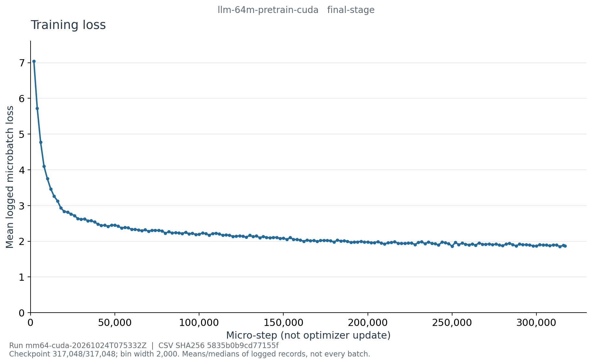

# E002c：CUDA LLM Pretrain 最终阶段曲线

类型：真实恢复文件 history 生成的图表，不是终端截图。训练 run：
`mm64-cuda-20261024T075332Z`，代码 `53f9b9f46560bee446d1c74e89cac991b71a8053`。
本页仅证明 LLM Pretrain 阶段的日志记录；不证明整个三模型实验完成或模型能力提升。

## 图表与源数据



- [学习率](learning_rate_last.png)
- [梯度范数](grad_norm_median.png)
- [含 padding 的训练吞吐](padded_tokens_per_second_median.png)
- [PyTorch CUDA 显存](cuda-memory.png)
- [分桶 CSV](curve-data.csv)、[来源与统计定义](curve-source.json)、[图表哈希清单](figure-manifest.json)

最终恢复文件覆盖 317,048/317,048 microsteps，经阶段完成事件、归档路径与 SHA 绑定后导出。
history 有 15,853 条，每 2,000 microsteps 固定分桶，共 159 桶；最后记录在 step 317,040，
最后 8 步没有日志点，不能补造这些值。最终部分桶上界为 318,000，并不表示训练超过预算。
首桶记录 loss 均值 7.040278，末桶为 1.870790；这是已记录 microbatch loss 的非加权均值，
不是每批训练 loss，也不是 token 加权验证 NLL。首末桶长度和记录数量不同。

学习率由约 5e-4 降到约 5e-5；吞吐曲线是已记录的进程段累计平均 padded tokens/s 的桶内
中位数，不是瞬时吞吐，也不是有效监督 token/s。显存是桶末日志点的 allocated/reserved 与
进程峰值，不是整张 GPU 的占用；不能由图中折线推断内存泄漏或其他任务资源。
单次运行不能提供重复实验不确定性或通用硬件性能结论。

## 复现和留存

服务器项目根目录：`/root/autodl-tmp/wlh_goya/MiniMind`。

```bash
.venv/bin/python reporting/training_curves.py export \
  --run-dir artifacts/runs/mm64-cuda-20261024T075332Z \
  --checkpoint artifacts/runs/mm64-cuda-20261024T075332Z/stages/llm-pretrain/llm-64m-pretrain-cuda.resume.pt \
  --stage llm-pretrain --final --output artifacts/runs/mm64-cuda-20261024T075332Z/curves/final-pretrain-source
.venv/bin/python reporting/training_curves.py plot \
  --source artifacts/runs/mm64-cuda-20261024T075332Z/curves/final-pretrain-source \
  --output artifacts/runs/mm64-cuda-20261024T075332Z/curves/final-pretrain-figures
```

上述目录已存在；重跑时必须使用新输出目录，不能覆盖既有证据。
完整 `history-records.json`、导出器 `curve-tool.py` 和渲染器 `renderer-tool.py` 均保留服务器，
不提交完整原始 history。公开 CSV SHA-256 为
`5835b0b9cd77155f4db2440001a4fc67341bfff45d2b5e2484336ddb4a085140`，
归档 resume SHA-256 为 `a087b33de93ccaea52bb18748c3893e2df9313c5b79ac1f848e77fc6d8eafa79`。
工具源文件 SHA、原始 history SHA 和各 PNG SHA 见本目录 JSON。

2026-10-25 独立重新计算全部 159 桶的记录数、loss 均值、吞吐中位数和末步号，
覆盖全部 history 无漏项；10 个曲线变换单元测试通过，5 张 PNG 已逐张查看，无标题/坐标/来源文字裁切。
这些 QA 不替代模型评估；参见[最终对话诊断](../../../cuda-llm-final-chat-diagnostic.md)。
