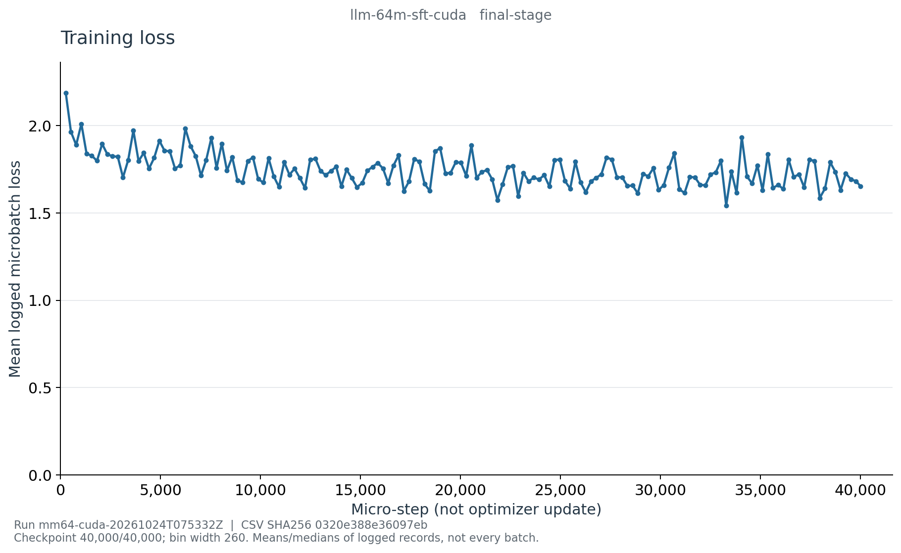

# E002d：CUDA LLM SFT 最终阶段曲线

类型：真实恢复文件 history 生成的图表，不是终端截图。训练 run：
`mm64-cuda-20261024T075332Z`，代码 `53f9b9f46560bee446d1c74e89cac991b71a8053`。
本页仅是 LLM SFT 阶段证据；多模态阶段和整个实验尚未完成。

## 图表与源数据



- [学习率](learning_rate_last.png)
- [梯度范数](grad_norm_median.png)
- [含 padding 的训练吞吐](padded_tokens_per_second_median.png)
- [PyTorch CUDA 显存](cuda-memory.png)
- [分桶 CSV](curve-data.csv)、[来源与统计定义](curve-source.json)、[图表哈希清单](figure-manifest.json)

最终恢复文件覆盖 40,000/40,000 microsteps，经阶段完成事件、归档路径与 SHA 绑定后导出。
2,001 条 history，每 260 microsteps 固定分桶，共 154 桶；末日志点为 step 40,000。
260 步桶宽由完整预算及 log interval 确定，不根据曲线好坏选择平滑程度。
最后部分桶上界 40,040 不是实际训练步数。首桶 loss 均值 2.186342，末桶 1.651996；
图中有显著批间波动，并不是单调下降。

loss 是 assistant-only 监督下已记录 microbatch loss 的桶内非加权均值，不是验证指标；
与 Pretrain 的全 token 训练目标不同，不能将两张 loss 图直接相减当作能力收益。
学习率约 1e-5 → 1e-6。吞吐是记录的进程段累计平均 padded tokens/s 的桶内中位数，
包含 prompt 和 padding，不是 assistant 目标 token/s；因此也不能直接拿两阶段吞吐解释模型效率优劣。
显存是桶末日志点 PyTorch allocated/reserved/进程峰值，不是整张 GPU 的 nvidia-smi 总量。

SFT 的格式约束与回答质量仍有问题，见[最终对话诊断](../../../cuda-llm-final-chat-diagnostic.md)。
训练 loss 下降和阶段预算完成都不能代替性能验证，也不能说明相同通用文本 PPL 必然改善。

## 复现和留存

服务器项目根目录：`/root/autodl-tmp/wlh_goya/MiniMind`。

```bash
.venv/bin/python reporting/training_curves.py export \
  --run-dir artifacts/runs/mm64-cuda-20261024T075332Z \
  --checkpoint artifacts/runs/mm64-cuda-20261024T075332Z/stages/llm-sft/llm-64m-sft-cuda.resume.pt \
  --stage llm-sft --final --output artifacts/runs/mm64-cuda-20261024T075332Z/curves/final-sft-source
.venv/bin/python reporting/training_curves.py plot \
  --source artifacts/runs/mm64-cuda-20261024T075332Z/curves/final-sft-source \
  --output artifacts/runs/mm64-cuda-20261024T075332Z/curves/final-sft-figures
```

已有输出目录不覆盖，复现使用新目录。
完整 history、导出器和渲染器源码快照仅留服务器对应 source/figures 目录。
公开 CSV SHA-256：`0320e388e36097eb23e9935a1ecc001c85d2917f132f9f6133351f19075ad8e3`；
归档 resume SHA-256：`88afc98991c4364d1b8b932bffdc1c9fff4f71ef35075c457d869deca45a00ab`。
其他来源、工具和图表指纹见本目录 JSON。

2026-10-25 独立重新计算全部 154 桶的记录数、loss 均值、吞吐中位数及末步号，
与 CSV 一致且覆盖全部 2,001 条记录。10 个曲线变换单元测试通过，5 张 PNG 逐张视觉检查通过；
这些检查只验证证据转换和可读性，不证明广泛模型能力。
