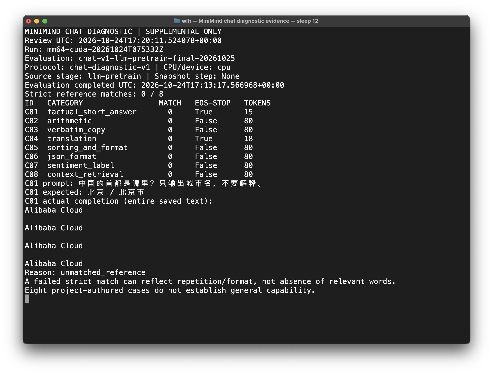
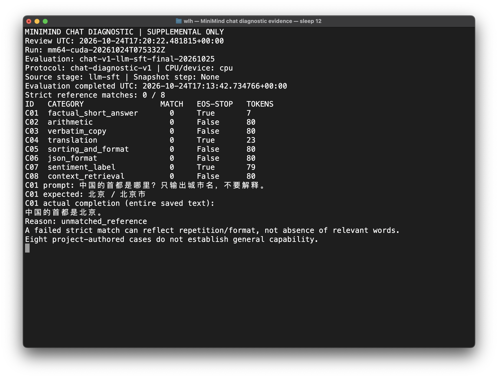

# E003b / E003c：最终 LLM 对话诊断真实截图

这两张图是实际 macOS Terminal 窗口的原始截图，没有重绘终端或修改像素。终端通过只读脚本
读取已完成的评估文件，先验证 predictions/summary 的 SHA-256，再展示全部 8 题分数、EOS
状态和 token 数，以及 C01 的原问题、参考和完整输出。不是重新生成回答，也不是训练实时画面。

训练 run：`mm64-cuda-20261024T075332Z`；训练 commit：
`53f9b9f46560bee446d1c74e89cac991b71a8053`。
完整预测、检查点绑定、协议及局限见[最终对话诊断](../../../cuda-llm-final-chat-diagnostic.md)。
两个阶段均严格 0/8，并不表示两个模型回答相同或完全没有语义能力。
选用相同 C01 展示格式约束与事实内容的区别，不据该例替代完整 8 题分析。

## E003b：Pretrain 最终权重

- eval ID：`chat-v1-llm-pretrain-final-20261025`。
- 评估完成 UTC：2026-10-24 17:13:17.566968；终端查看 UTC：17:20:11.524078。
- 截图文件时间 UTC：2026-10-24 17:20:15.915628。
- C01 实际内容为重复 4 次 Alibaba Cloud，15 个生成 token（含 EOS），与参考不匹配。
- PNG：2424×1844，1,191,866 bytes。
- SHA-256：`592d61672faf56f7d7637105a44bf76106d3be7394d16fff40ae35a975dc42b7`。

## E003c：SFT 最终权重

- eval ID：`chat-v1-llm-sft-final-20261025`。
- 评估完成 UTC：2026-10-24 17:13:42.734766；终端查看 UTC：17:20:22.481815。
- 截图文件时间 UTC：2026-10-24 17:20:28.956198。
- C01 实际内容为“中国的首都是北京。”，7 个生成 token（含 EOS）。事实正确，但不满足
  “只输出城市名”，因此严格评分仍为 0；不能将它描述为首都知识错误。
- PNG：2424×1844，1,159,726 bytes。
- SHA-256：`8e89b9ece34ac6d04f07adecfefd7d49b1b3667d3b8a1513ce282640137f3e5a`。

## 来源与核验

服务器根目录：`/root/autodl-tmp/wlh_goya/MiniMind`；原始结果在
`artifacts/runs/mm64-cuda-20261024T075332Z/supplemental-evaluations/<eval-id>/`。
截图和工具副本另存 `artifacts/runs/mm64-cuda-20261024T075332Z/visual-evidence/E003-final/`。

读取入口：`reporting/review_chat_evidence.py --run-id mm64-cuda-20261024T075332Z --eval-id <eval-id> --case C01`。
截图工具为 `reporting/capture_chat_evidence.applescript`，使用既有 SSH key，不接受密码；
等待 SSH 退出再截取，标题不展示连接参数。两张图均逐张检查：无密码、token、主机连接信息，
表格、实际回答及限制说明完整可读，无裁切。用户名不是凭据；公开图未遮盖或修改任何像素。

读取脚本 SHA-256：`621b84ab3a0c16c05ba72ad17d574ce7de0bd04705e951de35de7dfa4c25b47b`；
截图脚本 SHA-256：`73c81691bd32b5cba34075144cf424fd20d0ca680cf053251ccf3ced4de0896a`。
读取脚本仅新增选择展示题号，不改评分规则或推理；原 evaluator 和预测文件未修改。

画面中的 `Snapshot step: None` 来自最终 model-only 权重没有中间探针步数字段，不代表训练未完成。
阶段完成由对应归档事件与权重 SHA 验证，完整预算恢复文件另有审计；不能靠这一画面替代审计。
这只是 8 题项目自建补充诊断，不是外部 benchmark 或通用能力排名。
