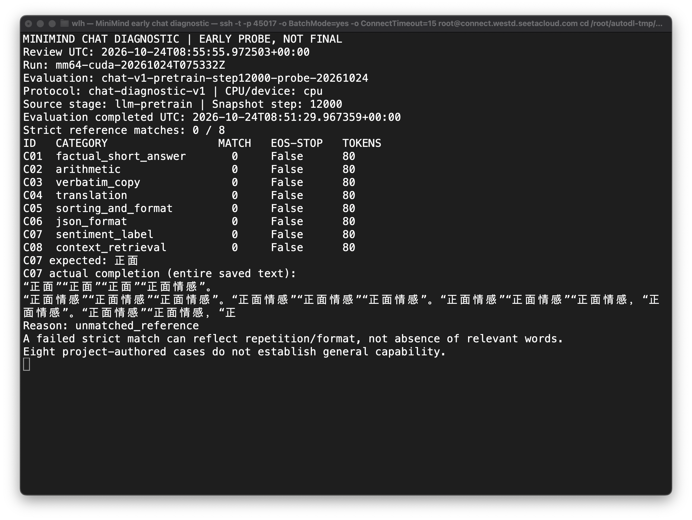

# E003a 早期对话诊断与实际失败输出

这是预训练 step 12,000 已审计快照的 **CPU 执行器测试**，不是完整预训练、SFT 或最终模型结果。
评估 ID 为 `chat-v1-pretrain-step12000-probe-20261024`，独立于原先四条基础提示和 32 条文本诊断。
固定八题协议与解释见 [chat diagnostic v1](../../../../reporting/protocols/README.md)。

## 实际结果与解释

[精简评分摘要](summary.json)记录严格参考匹配为 0/8。八条均生成到 80 token 上限，没有遇到 EOS。
该小型项目诊断不能证明模型“完全没有知识”，也不支持通用能力准确率结论。

| 题号 | 任务 | 实际观察 | 严格评分 |
|---|---|---|---|
| C01 | 城市名短答 | 生成“信息”与重复的“美国”，未回答北京 | 0 |
| C02 | 2 加 3 | 转为重复英文片段，没有按要求输出数字 | 0 |
| C03 | 原样复制 | 生成重复“蓝色”的编号列表，没有复制指定字符串 | 0 |
| C04 | cat 翻译 | 改写为另一条英文句子的翻译任务 | 0 |
| C05 | 排序与逗号格式 | 反复输出“数字”，未给出排序结果 | 0 |
| C06 | JSON 对象 | 输出“用户输入”的重复列表，不是合法 JSON | 0 |
| C07 | 情感标签 | 出现正确词“正面”，但持续复读且未遵守仅输出标签 | 0 |
| C08 | 上下文号码提取 | 重复“小林”，没有输出小周的号码 26 | 0 |

表格是原始输出的精简描述，不是逐字引用。C07 尤其说明：相关词出现、语义倾向和严格格式遵循
不是同一件事。不能用“0/8”掩盖这种区别；也不能把出现“正面”认作已满足完整指令。
只有后续相同协议下的完整阶段结果，才能用于阶段间比较；不将此早期快照直接当成最终 Pretrain 基线。

## 真实截图



这是新打开的 macOS Terminal 窗口，通过已授权的 SSH 只读查看真实结果后截取，未重绘终端或
修改结果像素。终端查看时间为 2026-10-24 08:55:55.972503 UTC。画面明确标有
`EARLY PROBE, NOT FINAL`，展示八题结果与 C07 完整已保存回答。
截图文件生成时间为 2026-10-24 08:56:02 UTC，与终端查看时间分开记录。

PNG SHA-256：`5eccf98ec1c007b7e0caebf33d5514f14c73fb3d91fb6c3ec095a3cd9daa7d52`。

## 追溯与保留

原始评估目录位于服务器：

```text
artifacts/runs/mm64-cuda-20261024T075332Z/supplemental-evaluations/
  chat-v1-pretrain-step12000-probe-20261024/
```

执行时间：2026-10-24 08:51:05 至 08:51:29 UTC。目录保留逐样本预测、参考、实际 chat prompt、
token IDs、EOS 行为、耗时、协议副本、执行器副本、manifest 与来源描述勘误。

| 项目 | SHA-256 |
|---|---|
| 模型快照 | `5e4c300812d07123fef0602f12eb11da0a1ca47a27780d6dc073672f8791ac59` |
| 冻结协议 | `af230c71f939b0c663a6dbfa681d1046c6d34c9fe89c5e8c7f94e4c2b6ccb98c` |
| 实际执行器副本 | `91f335034df6fe38b86d5418f49f79850ea1f3a981ffbdd764274d5b509fbb41` |
| 原始逐样本 JSONL | `78f1641301d57f9ff47f229053cccc1fc6d4682151ab6415a25aadacd10f55f6` |
| 评分摘要 | `021b2973a206319301737387a7c7635ab9e3dec38c1c450771b54d71b244e049` |

协议原始作者描述已单独勘误为助手构造的项目诊断，而非人类受试或外部人工标注数据；
原冻结题目、参考答案、评分规则、预测和分数没有改变。完整逐样本输出不上传 GitHub。
已实测拒绝将此未归档早期快照当作正式阶段评估，且没有留下伪正式输出目录。
