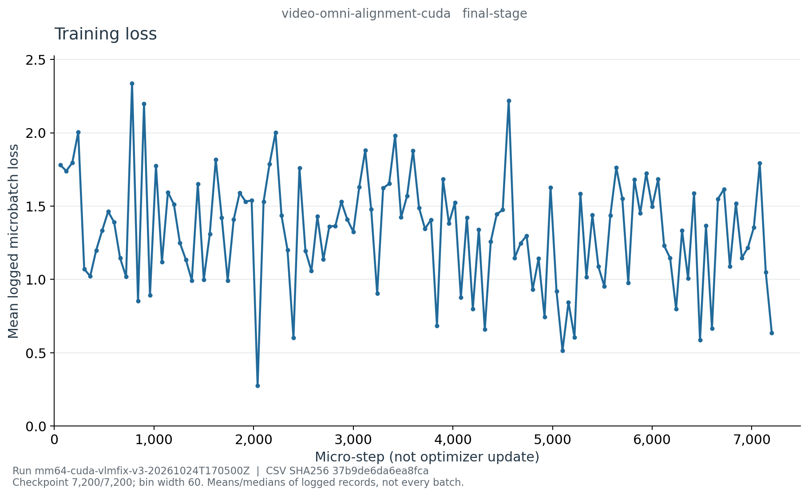

# E002g：Video Alignment 最终曲线

- [学习率](learning_rate_last.png)、[梯度范数](grad_norm_median.png)
- [Padded吞吐](padded_tokens_per_second_median.png)、[PyTorch显存](cuda-memory.png)
- [CSV](curve-data.csv)、[来源定义与哈希](curve-source.json)、[PNG清单](figure-manifest.json)

这是最终恢复文件history生成图，不是终端截图或时序能力证据。
run `mm64-cuda-vlmfix-v3-20261024T170500Z`，代码`9eafe5a548df7d5eae7ce2efe420e512a52d647e`。
7,200/7,200步、900次更新；361条history按固定60-step分为120桶。
每桶通常只有3条日志（首桶多一条），图中波动不是每步loss的完整轨迹，不代表阶段故障。
首末桶loss均值为1.779987931和0.636228164，不能据此宣称时序理解改善。

吞吐是段累计平均padded token/s记录的桶内中位数，训练使用预缓存视觉特征，
不是含视频解码/视觉前向的端到端吞吐；显存是桶末PyTorch进程数值，不是全卡。
全部120桶的记录数、loss均值、吞吐中位数、末步号已独立复算，覆盖所有361条history；
5张PNG逐张查看通过，source/CSV/图像SHA核验一致。

服务器根目录`/root/autodl-tmp/wlh_goya/MiniMind/experiments/vlm-slot-v3`，原始来源位于
`artifacts/runs/mm64-cuda-vlmfix-v3-20261024T170500Z/curves/final-video-alignment-source/`，
图和渲染工具副本在同级`final-video-alignment-figures/`；完整history仅留服务器。
复现使用`reporting/training_curves.py export --stage video-omni-alignment --final`，
传入本run与归档resume后再`plot`；新执行另用输出目录，不覆盖既有证据。
阶段完成与验证口径详见[阶段报告](../../../cuda-video-alignment-final.md)。
