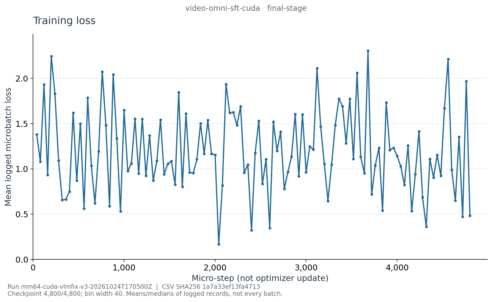

# E002h：Video SFT 最终日志曲线

- [学习率](learning_rate_last.png)、[梯度范数](grad_norm_median.png)
- [Padded吞吐](padded_tokens_per_second_median.png)、[PyTorch显存](cuda-memory.png)
- [CSV](curve-data.csv)、[来源和定义](curve-source.json)、[PNG哈希](figure-manifest.json)

这是最终归档恢复文件的history生成图，不是真实终端截图，也不是时序能力证据。
run `mm64-cuda-vlmfix-v3-20261024T170500Z`，训练代码 `9eafe5a548df7d5eae7ce2efe420e512a52d647e`。
最终4,800/4,800 microsteps、600次更新；241条history分成120个固定40-step桶。
每桶通常仅2条日志（首桶3条），不是所有训练batch；曲线连线不表示补全了未记录的loss。

全部120桶的loss均值/最小/最大、学习率、梯度中位数、吞吐中位数、显存、耗时和末步号均已独立复算，
覆盖241条history；5张PNG逐张检查通过，CSV、source和PNG的SHA与清单一致。
首末桶loss均值1.379223704→0.483145162，但中间大幅波动，不能挑选低末点当作能力提升。
梯度图记录最近更新的裁剪前norm，不表示梯度裁剪失效。

吞吐为日志中的段累计平均padded token/s的桶内中位数，包含padding和非监督上下文；训练使用
预计算视觉缓存，不代表MP4解码＋SigLIP前向的端到端速度。显存为桶末PyTorch进程数据，不是全卡。

服务器根目录 `/root/autodl-tmp/wlh_goya/MiniMind/experiments/vlm-slot-v3`；原始history、工具与
来源在本run的 `curves/final-video-sft-source/`，图像与渲染工具在 `curves/final-video-sft-figures/`。
原始history和权重不上传GitHub。复现命令使用 `reporting/training_curves.py export --stage video-omni-sft --final`
传入本run和精确归档resume，再执行`plot`，输出另设新目录、不覆盖已有证据。

能力指标和负面结论见[最终视频评估解读](../../../cuda-video-sft-final.md)。
