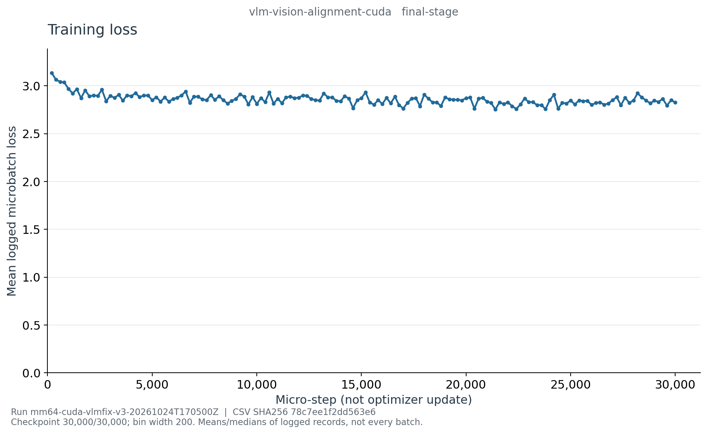

# E002e：VLM Alignment 最终阶段曲线

这是恢复文件 history 生成的图表，不是真实终端截图，也不是视觉能力评估。
run：`mm64-cuda-vlmfix-v3-20261024T170500Z`；训练 commit：`9eafe5a548df7d5eae7ce2efe420e512a52d647e`。

- [学习率](learning_rate_last.png)、[梯度范数](grad_norm_median.png)
- [含 padding 的吞吐](padded_tokens_per_second_median.png)、[PyTorch CUDA 显存](cuda-memory.png)
- [精简 CSV](curve-data.csv)、[来源与统计定义](curve-source.json)、[PNG 校验清单](figure-manifest.json)

最终预算 30,000/30,000 步、7,500 次更新。使用精确阶段归档 resume SHA
`07f163cedbb320928a8a3ece33334af11215ea476ed705bd16e182379b1df6f4`，并核对阶段完成事件。
1,501 条 history 分为 150 个固定 200-step 桶，第一条记录 step 1，最后 step 30,000。
loss 是已记录 microbatch loss 的非加权均值；吞吐为记录的进程段累计平均 padded token/s
的桶内中位数，包含未监督上下文和 padding，不是即时或有效监督 token/s。
显存为桶末 PyTorch allocated/reserved/进程峰值，不是整卡总量，不代表外部冻结模型文件大小。

首末桶 loss 均值为 3.134774750 → 2.826269770；学习率约 4e-4 → 4e-5。
曲线下行不证明问答正确或视觉依赖成立；完整[阶段解读](../../../cuda-vlm-alignment-final.md)另列指标边界。

服务器根目录：`/root/autodl-tmp/wlh_goya/MiniMind/experiments/vlm-slot-v3`；
源目录：`artifacts/runs/mm64-cuda-vlmfix-v3-20261024T170500Z/curves/final-vlm-alignment-source/`；
图目录同级 `final-vlm-alignment-figures/`。完整 history 和当次导出器/渲染器源码快照仅留服务器。
公开 CSV SHA-256：`78c7ee1f2dd563e68587c7892d4578bf72cda8e1af762258ef69ba7ab8076c49`。

复现使用 `reporting/training_curves.py export --stage vlm-alignment --final`，传入上述 run 及
`stages/vlm-alignment/vlm-alignment-cuda.resume.pt`；再以 `plot` 渲染。
必须使用新的输出目录，不覆盖已有证据。

全部 150 桶的记录数量、loss 均值、吞吐中位数和末步号已独立复算，覆盖所有 history；
来源/CSV/5 PNG 哈希核验一致，5 PNG 均逐张检查，无标题、坐标与来源文字裁切。
