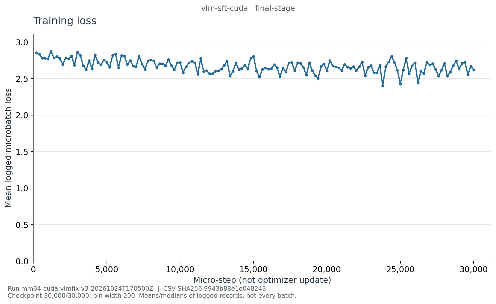

# E002f：VLM SFT 最终阶段曲线

这是实际最终恢复文件 history 生成图，不是运行截图或视觉能力证明。
run `mm64-cuda-vlmfix-v3-20261024T170500Z`；训练 commit `9eafe5a548df7d5eae7ce2efe420e512a52d647e`。

- [学习率](learning_rate_last.png)、[梯度范数](grad_norm_median.png)
- [Padded throughput](padded_tokens_per_second_median.png)、[PyTorch CUDA 显存](cuda-memory.png)
- [CSV](curve-data.csv)、[来源与完整统计定义](curve-source.json)、[各图SHA](figure-manifest.json)

30,000/30,000 microsteps、3,750 次更新，最终归档 resume SHA 为
`a50869adec6322d31ff1117b14a2ab43b8c971f7ef933408d63f95eb6933835c`，阶段完成事件已核验。
1,501 条 history 固定分为150个200-step桶，覆盖 step 1–30,000。
loss是日志微批均值，LR是桶末记录；梯度是最近更新范数的桶内中位数。
吞吐为已记录的进程段累计平均 padded tokens/s 的桶内中位数，不是瞬时有效监督token/s；
显存为桶末 PyTorch 数值，不是整卡占用。首末桶loss为2.853958390与2.618599463。

150桶记录数、loss均值、吞吐中位数和末步号已独立复算，覆盖全部history。
5张PNG均已逐张查看，无标题/坐标/来源文字裁切，CSV/source/PNG哈希一致。
统计和视觉QA不代表模型能力通过，见[阶段评估与失败解读](../../../cuda-vlm-sft-final.md)。

服务器原始来源位于工作目录
`/root/autodl-tmp/wlh_goya/MiniMind/experiments/vlm-slot-v3/` 下的
`artifacts/runs/mm64-cuda-vlmfix-v3-20261024T170500Z/curves/final-vlm-sft-source/`；
图目录为同级 `final-vlm-sft-figures/`，均保留当次工具源码快照。完整 history 不上传GitHub。
复现使用 `reporting/training_curves.py export --stage vlm-sft --final`，传入本run与最终归档resume，
然后 `plot`；输出需另用新目录，不覆盖既有证据。
