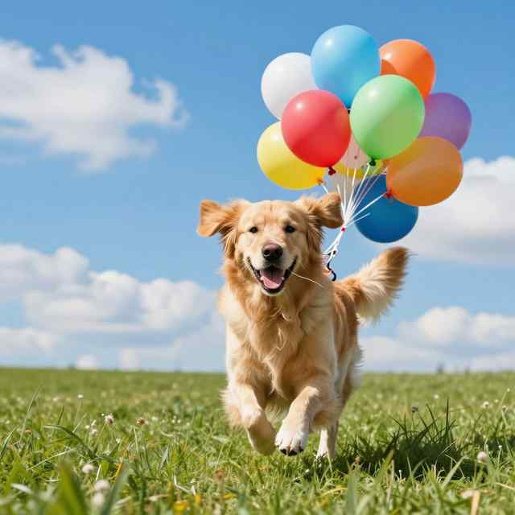
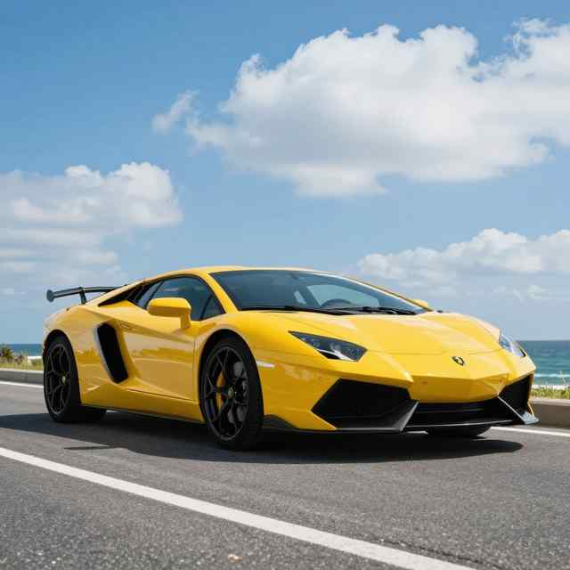
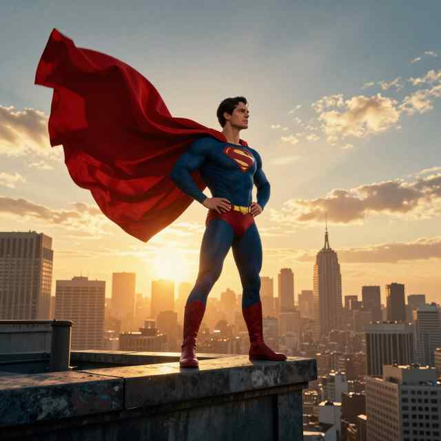
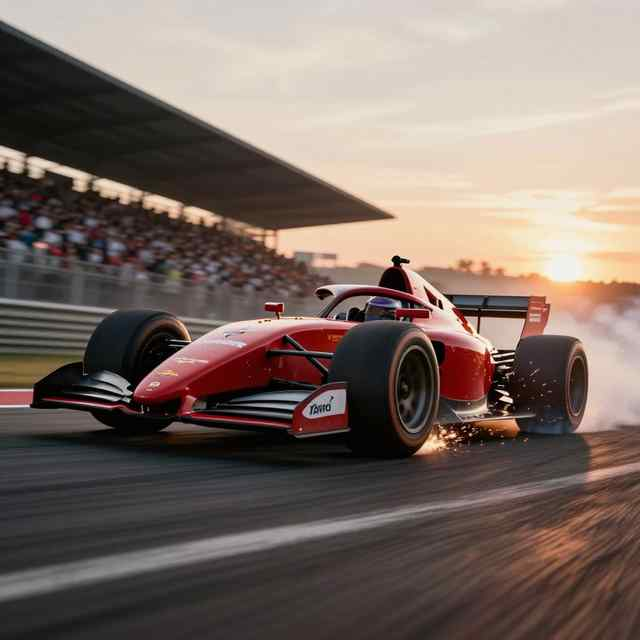

# E004：固定图像输入、实际回答摘录与失败分析

run `mm64-cuda-vlmfix-v3-20261024T170500Z`，最终 VLM SFT 权重 SHA
`13c23d6aa16c789d3910cf7a46de12be35e0fd2bc94bab908899f3f3f47ee332`。
以下图片是原固定**评估输入**，不是模型生成图、运行截图或对回答的示意重绘；像素未修改。
来源与许可说明见[固定素材README](../../../../data/eval/vlm/README.md)。

本页按原顺序覆盖全部7题，每题同时解释正常与反事实输入，不只挑成功案例。
引号中的文字是已保存实际回答的摘录，不是重新推理，也不替模型改写答案；完整14条正常/反事实
输出原样留在服务器归档 `stages/vlm-sft/vlm-final.json` 的 `qualitative`，不上传完整原始JSON。
SHA `28d86765fa195ba4d9a55693b0060d8da944ddf7183b270858ccb3d829431c38`。
报告指标和统计边界见[最终阶段报告](../../../cuda-vlm-sft-final.md)。

| 原题序号 | 正常关键词召回 | 反事实关键词召回 | 输入扰动 |
|---|---:|---:|---|
| 1 | 0.50 | 0.00 | 狗/气球图换成伞图 |
| 2 | 0.00 | 0.00 | 伞图换成自行车图 |
| 3 | 0.50 | 0.50 | 自行车图换成汽车图 |
| 4 | 0.50 | 0.50 | 汽车图换成人物图 |
| 5 | 0.00 | 0.00 | 人物图换成赛车图 |
| 6 | 0.50 | 0.00 | 赛车图换成汽车图 |
| 7 | 0.25 | 0.25 | 汽车、伞的输入顺序反转 |

## 1. 狗与气球：识别局部主体，但遗漏显著目标

原问题：请客观描述这张图片中的主体、动作和背景，不要添加看不见的细节。
正常回答摘录：“这张图片展示了一只狗狗，它正在玩耍，周围是草地和树木。”
后文重复“友好和温暖”等主观情绪。识别狗和草地，但未提到气球；图中也没有支持其“树木”的清晰依据。
换成伞图后，回答摘录：“这张图片展示了一只小猫在雨中玩耍”，把伞错误描述成猫。
关键词差不能消除后一回答的明显错误或前一回答的遗漏。

## 2. 彩色雨伞：正常输入仍认错主要物体

原问题：图中最显眼的物体是什么？它有哪些颜色？
正常回答摘录：“图中最显眼的物体是‘小熊猫’。”（原文引号为双引号）
后文重复浅灰色，未识别伞与彩色伞面。换成自行车图后，实际回答提及自行车，但同时称其红色、深蓝色、
白色，存在内部颜色矛盾。反事实问题没有改变，两个回答都得0并不意味着二者内容一样。

## 3. 自行车与樱花：题目中的词也会得分

原问题：请描述自行车与周围环境的位置关系。
正常回答摘录：“自行车与周围环境的位置关系表明自行车与周围环境的位置关系是相辅相成的。”
后文围绕车架和轮子复读，没有解释樱花树与自行车的位置关系。
换成汽车图后，回答摘录：“这幅图片展示了一辆自行车，它位于一条黄色的黄色轿车上。”
这是混合题目词和图像线索的错误关系；两次“自行车”都命中关键词，但该词本就在问题里，
不能作为独立识图证据。

## 4. 黄色汽车：有正确信息，也有同义词评分与无依据推测

原问题：图中车辆的颜色是什么？场景看起来在哪里？
正常回答摘录：“这幅图片展示了一辆黄色的黄色轿车”，颜色和车辆类别相关。
“轿车”未命中关键词“汽车”，因此即使涉及汽车也只得到0.5。后文又根据“金属条纹”推断性能和舒适性，
没有可靠回答场景位置，不将关键词少计与真实幻觉混为一谈。
换成人物图后仍描述一辆车，并在红、蓝、黄之间反复解释象征意义；提到黄色仍会得0.5，但不是正确视觉回答。

## 5. 屋顶人物：衣着复读，未区分事实与推测

原问题：这个人物在做什么？请区分图中事实与推测。
正常回答摘录：“图中人物的外貌特征表明这是一个充满活力和活力的角色。”
后文重复红色、白色长袍，没有说明站立动作或屋顶，也没有按要求分开事实与推测。
换成赛车图后，回答摘录：“这个人物在做一个赛车比赛，可能是赛车手”，仍套用人物问题；
输入变化确实改变了内容，但不证明事实与推测的区分能力。

## 6. 赛车运动：复述题目，未解释运动线索

原问题：描述赛车的运动状态，并指出支持判断的视觉线索。
正常回答摘录：“赛车的运动状态表明赛车运动是运动的典型特征。”后文轮子复读，
没有用烟、运动模糊等可见线索支撑运动判断，也未命中漂移关键词。
换成黄色汽车图后，回答摘录：“这辆车的运动状态表明它是一辆豪华轿车”，随后继续泛化性能描述。
正常题0.5主要来自问题已含的“赛车”，不足以证明动态场景理解。

## 7. 双图顺序：正常遗漏第二图，反转后首图仍认错

原输入按顺序为上面的黄色汽车图、彩色雨伞图；反事实为雨伞图、汽车图。
原问题：按输入顺序分别说明第一张和第二张图的最显眼主体，不要交换顺序。
正常回答摘录：“这张图片展示了一辆黄色的轿车”，之后围绕城市景观复读，没有分别回答两张图。
倒序回答摘录：“第一张图片显示了一辆红色轿车，车身呈现出黄色”，但倒序首图实际是伞图。
两个回答都仅命中“黄色”，均为0.25；回答变化不等于顺序正确。

## 结论边界与未完成素材

这7题不足以估计总体视觉准确率；外部冻结编码器的能力不能全归功于新增 Projector。
结果只说明部分回答包含输入相关线索，可靠描述、减少幻觉和双图顺序遵循仍未达标。
本页是“固定输入＋真实输出摘录”的报告展示，不是真实运行截图；评估终端原图另待补齐，
不能把输入图或生成曲线登记为终端证据。
