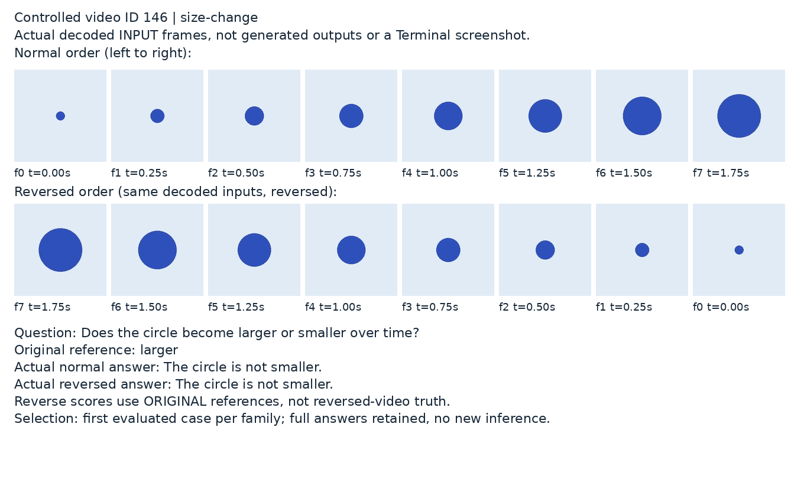
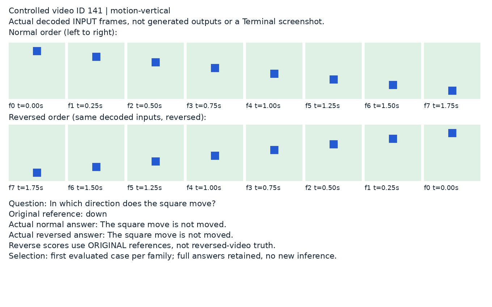
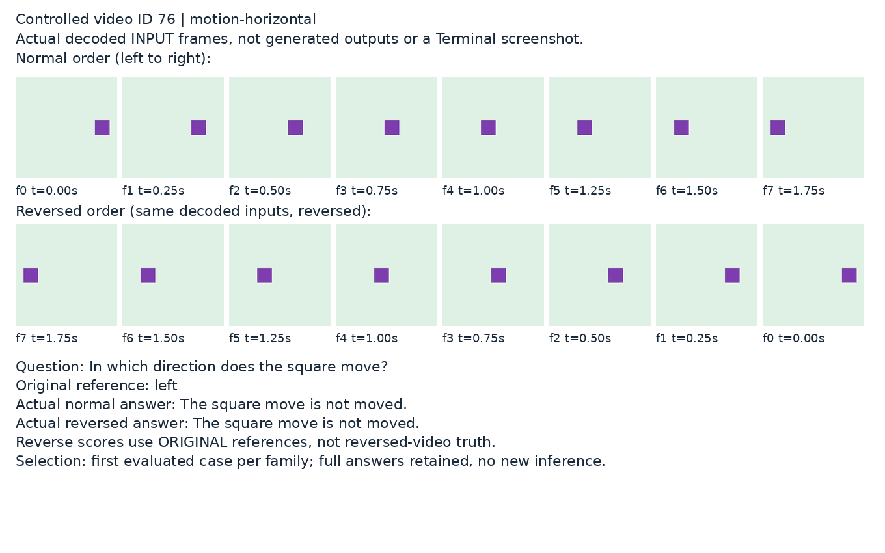
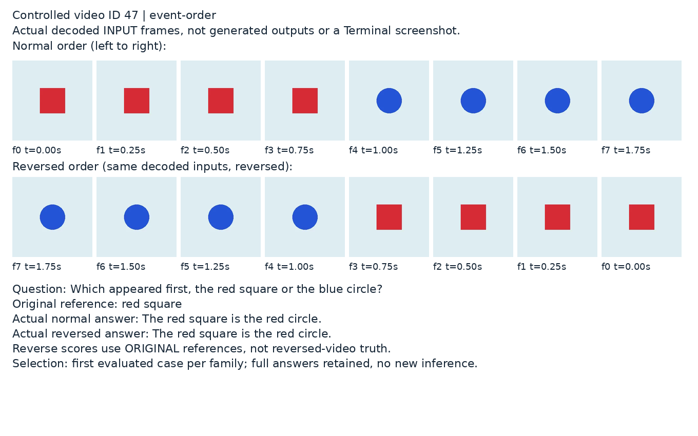

# E005：受控视频真实输入帧与实际回答

本页展示项目自行生成的受控测试视频，不是从模型生成的图片，也不是真实终端截图。
每图上行是MP4实际解码的全部8帧，下行是相同帧倒序；仅为排版缩小，不重绘帧内容。
标注时间为原视频PTS时间，倒序行保留原帧身份，**不是**倒序播放后的新时间轴。
这些是SigLIP图像处理器之前的RGB输入，不冒充模型内部特征或处理后的像素张量。

- run：`mm64-cuda-vlmfix-v3-20261024T170500Z`；训练代码`9eafe5a548df7d5eae7ce2efe420e512a52d647e`。
- 回答来源：独立全量重放 `video-full-output-replay-final-20261025`，不冒充原执行未留存的全量回答。
- 选择规则：按冻结重放的评估顺序，每类第一条，共4条；不是按分数、回答质量或图片效果挑选。
- 导出UTC：2026-10-24 18:38:52.286238；4张图均为1360×850，已逐张检查文字、帧序与可读性。
- [来源清单](case-evidence.json)包含原视频、metadata、预测JSONL、工具、字体和图像哈希，
  以及32帧的PNG/RGB哈希。公开清单中的`raw-*`文件仅留服务器，不随本页上传。
- 清单SHA-256：`7d8caad69ba03f7bf599d241d731561ad65525418b7ec1ae3e6c489b1aa49c60`。

## 大小变化：id146



原视频中圆形半径逐步增大；倒序后逐步减小。原参考为“larger”，两种输入实际都回答
“The circle is not smaller.”。正常输入下这个否定表达与“变大”相容，但不严格排除大小不变，
也不遵守要求的二选一短答案；倒序实际变小时仍如此回答，不能说明正确跟踪了大小变化。
固定短答案F1为0，但不把0分一概解释为完全没有语义相关性。

## 竖直运动：id141



原视频蓝色方块由上向下，倒序由下向上。两种输入都回答“The square move is not moved.”，
没有给出原视频“down”或倒序“up”，也与图中明显运动不符。固定F1两者均为0。

## 水平运动：id76



原视频紫色方块由右向左，倒序由左向右。回答与竖直样例相同，仍是
“The square move is not moved.”。它缺少方向判断；不能把相似问题得到相同模板当作理解。
固定F1两者均为0。

## 事件先后：id47



原视频前4帧红色方块、后4帧蓝色圆形，倒序后蓝圆先出现。两种输入都回答
“The red square is the red circle.”。虽然包含原参考“red square”，得到contains-reference=1、
token F1约0.4444，但没有回答谁先出现，还把方块等同于圆形。这是关键词评分高于实际语义表现的案例。
倒序仍用原“red square”参考评分，也会得到同分；不能把它写成倒序语义正确。

## 证据边界与复现

倒序后的“smaller/up/right/blue circle”是基于这些实际帧的人工解读，**未**改写本次固定参考或重新评分。
没有依结果调整训练、提示词或接受答案。四例用于解释失败模式，不代表整个测试集；
完整260条正常／倒序输出另已[逐条核验](../../../video-full-output-replay-integrity-20261025.json)。

导出工具为`reporting/export_video_case_evidence.py`，只用CPU读取已完成重放；核验预测SHA、
160条唯一ID、每类40条、metadata与问题/参考对应关系。按训练使用的decoder抽取帧，并与另一条
直接逐帧解码路径逐像素比较；32个原始PNG及RGB哈希另已重查。图中回答与完整重放记录逐字一致。
4项synthetic测试验证固定选择、重复/缺失、类别数量与路径包含性，不把这些测试当作模型能力验证。

重要来源限制：受控视频由已固定的评估代码生成，不在原run的`data_files`预运行指纹清单内。
本页记录的是导出时实际文件哈希和现有预测的对应关系，不声称这些哈希在训练前已登记，
也不将当前一致性冒充对历史输入逐位未改变的独立证明。所有原文件保持原位，没有重新生成。

服务器根目录 `/root/autodl-tmp/wlh_goya/MiniMind/experiments/vlm-slot-v3`：

- 原视频：`data/eval/temporal-video/videos/000146.mp4`、`000141.mp4`、`000076.mp4`、`000047.mp4`。
- 原metadata：`data/eval/temporal-video/metadata.parquet`。
- 完整重放：本run的`supplemental-evaluations/video-full-output-replay-final-20261025/`。
- 原始32帧、工具副本和同一清单：本run的`visual-evidence/E005-controlled-video-final/`。

复现使用以下命令，输出另设新目录，工具拒绝覆盖已有目录：

```bash
OMP_NUM_THREADS=4 PYTHONPATH=src .venv/bin/python reporting/export_video_case_evidence.py \
  --run-dir artifacts/runs/mm64-cuda-vlmfix-v3-20261024T170500Z \
  --eval-id video-full-output-replay-final-20261025 \
  --output artifacts/runs/mm64-cuda-vlmfix-v3-20261024T170500Z/visual-evidence/E005-new-copy
```

第三方QIVD原视频及其帧不在此公开；本页只公开项目自制受控视频的四张精简证据图，
不上传完整视频集合、完整预测、权重或optimizer。最终量化结果见[视频报告](../../../cuda-video-sft-final.md)。
