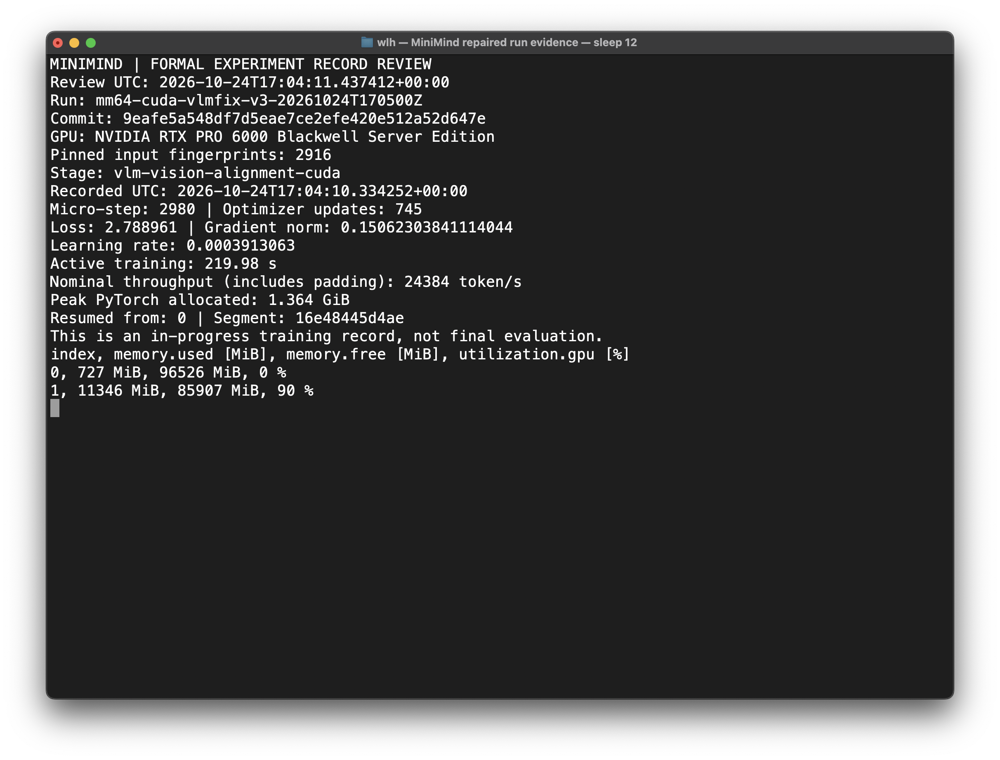
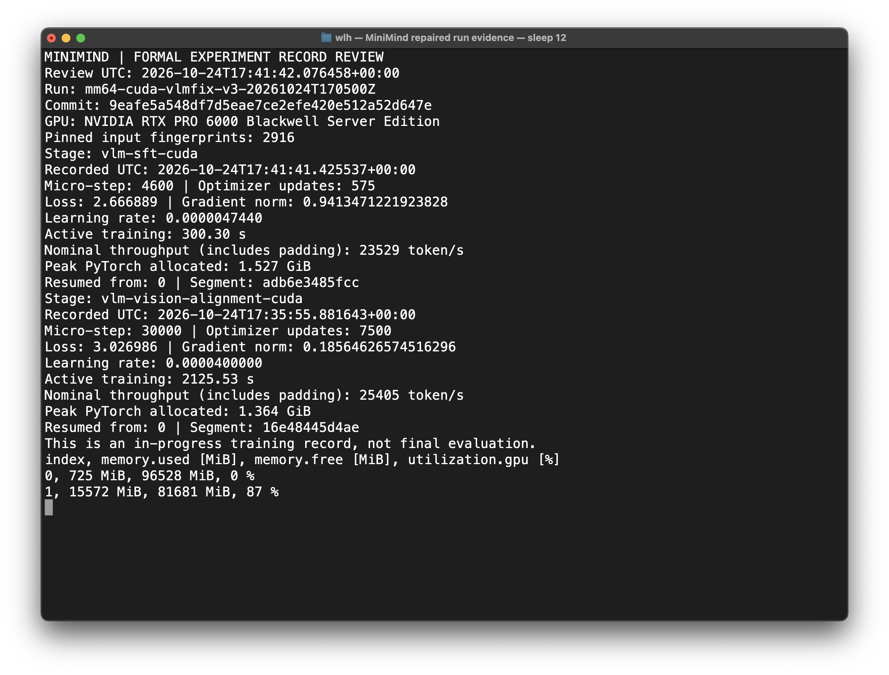
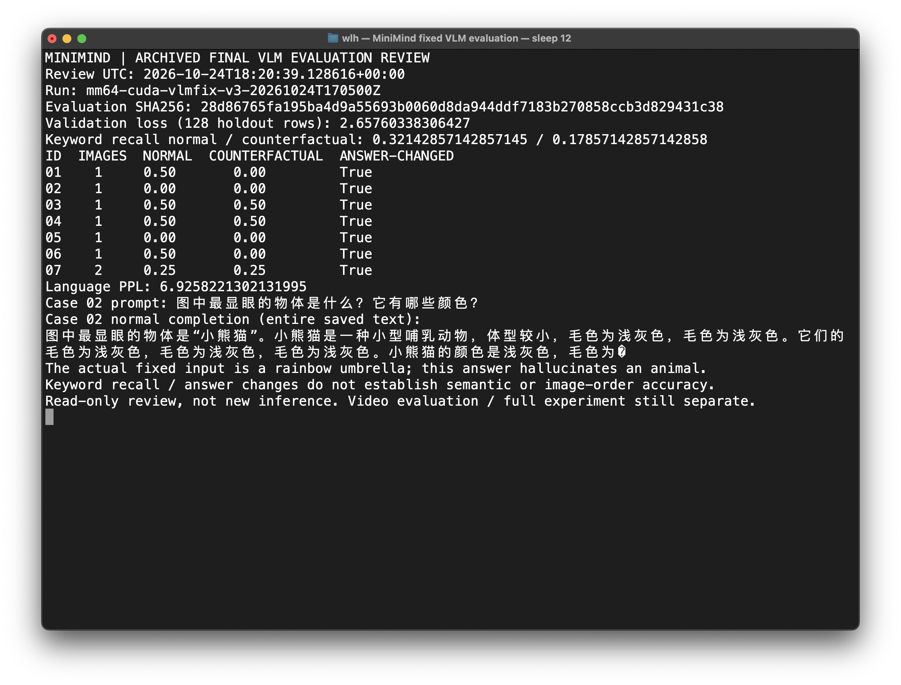
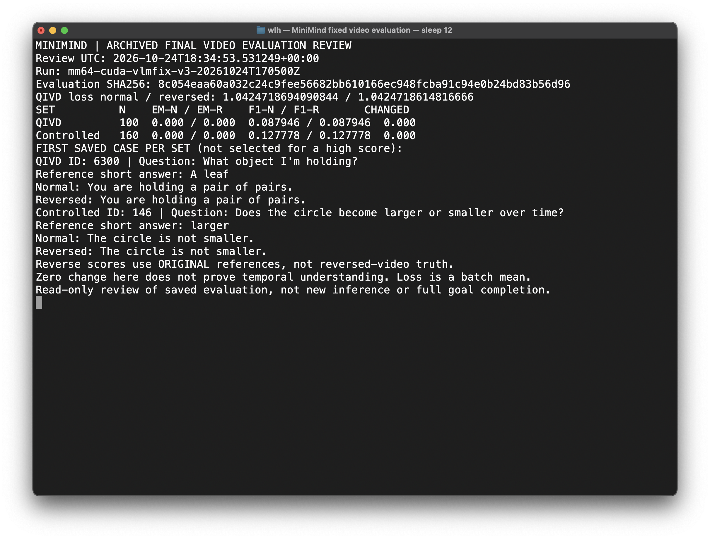

# E008：修复运行启动后的真实终端证据

- Run：`mm64-cuda-vlmfix-v3-20261024T170500Z`；代码 `9eafe5a548df7d5eae7ce2efe420e512a52d647e`。
- 类型：实际 macOS Terminal 窗口截图，未重绘终端或修改像素，不是模型架构图。
- 查看时间：2026-10-24 17:04:11.437412 UTC；截图保存时间：17:04:17 UTC。
- 原始指标：step 2,980、`recorded_at_utc=2026-10-24T17:04:10.334252+00:00`、
  segment `16e48445d4ae`，来自新 run 的 `metrics/vlm-vision-alignment-cuda.jsonl`。
- 内容：2,916 个输入指纹、GPU 型号、745 次 optimizer update、loss/LR/梯度、活跃耗时、名义
  padded 吞吐、PyTorch 进程 peak 和实际整卡资源查询。全卡占用不能全部归因于本 run。
- PNG SHA-256：`677c3d2ab56cf20b9b5c7c175c0bfe4819884931f0dfd2e8ad7facacdcecf469`。
- 捕获入口：[capture_run_evidence.applescript](../../../reporting/capture_run_evidence.applescript)。
  SSH 完成后才捕获窗口，避免活动进程标题泄露连接参数；没有密码或 token。

已视觉检查：运行身份、时间、数字、脚注和 GPU 表格可读，未发现遮挡或敏感凭据。
这是启动后的中间记录，不证明已经越过原故障步、完成训练或建立视觉能力。
完整继承关系与故障说明见[修复运行登记](../../cuda-vlm-repair-run.md)。

## E009：Alignment 末步与 SFT 启动记录

- 类型：macOS Terminal 真实窗口原图，无重绘、无像素修改；不是能力评估截图。
- 终端查看 UTC：2026-10-24 17:41:42.076458；PNG 保存 UTC：17:41:46.859572。
- 内容：Alignment 最终日志 30,000 步 / 7,500 更新，及 SFT step 4,600 / 575 更新；
  后者指标时间为 17:41:41.425537 UTC、segment `adb6e3485fcc`。
- PNG：2424×1844，1,275,416 bytes；SHA-256：
  `dd6050677451246ba5c5b7e2663a33d21d820f38138bbacc273ad85e322dc225`。
- 工具沿用上面的 `capture_run_evidence.applescript`，只读查看已记录指标并查询 GPU，
  未重新训练或修改结果。已检查：身份、时间、数值、脚注完整，未出现密码、token 或连接参数。
- 全卡显存同时包括其他进程，不能把 GPU1 的 15,572 MiB 全归因于本模型；GPU0 非本项目。
- 截图仅显示训练记录；Alignment 的最终完成还需结合[阶段验证、审计与归档](../../cuda-vlm-alignment-final.md)。
  SFT 当时仍在运行，不能把该截图当作整个 VLM 或六阶段完成证据。

## E002e：Alignment 最终日志图表

[5 张最终曲线与来源](E002-vlm-alignment-final/README.md)是最终归档 history 生成图，
与上述真实截图分开登记。

## E010：固定 VLM 评估真实终端截图

- 实际macOS Terminal原图，无重绘、无像素修改；只读查看完成阶段的归档评估，不是重新推理。
- 查看UTC：2026-10-24 18:20:39.128616；文件保存UTC：18:20:44.107980。
- 先核对阶段完成事件、归档路径及评估SHA，再显示全部7题正常/反事实分数、语言PPL，
  以及第2题的原问题和完整正常回答，明确其把伞描述为小熊猫的错误。
- PNG：2424×1844，1,230,381 bytes；SHA-256：
  `ff9a85a01d19a07a034417186f6e4321ab74058ef0ec39197889db3587cc7169`。
- 入口：`reporting/review_vlm_evidence.py --run-id mm64-cuda-vlmfix-v3-20261024T170500Z`；
  `capture_run_evidence.applescript`新增可选`vlm-evaluation`视图，默认训练截图行为不变。
- 逐张检查：表格、来源、完整回答与限制说明可读，无裁切、密码、token或连接参数。
  回答末尾的替代字符来自原解码文本，未改成“干净答案”，不是为美化结果而删去。
- 读取器5个synthetic测试覆盖正常读取、篡改、不完整阶段、非法run ID、越界归档；
  实际归档另外验证。全部reporting工具43项测试通过，不把这些测试当作模型性能通过。
- [7个固定输入与全部案例分析](E004-vlm-fixed-cases/README.md)是输入图和报告摘录，
  与本真实终端截图分开登记；[VLM最终报告](../../cuda-vlm-sft-final.md)不宣称视觉能力达标。

## E002f / E002g：新增最终日志图表

[VLM SFT](E002-vlm-sft-final/README.md)与[Video Alignment](E002-video-alignment-final/README.md)
各包含5张最终曲线、CSV及来源/图像校验信息，均不是运行截图。

## E002h：Video SFT 最终日志图表

[5张最终曲线、120桶CSV和完整来源定义](E002-video-sft-final/README.md)已逐桶复算、逐图检查。
这是日志生成图而非终端截图；不能以loss末点较低推断视频理解改善。

## E011：最终视频评估真实终端截图

- 类型：macOS Terminal真实窗口原图，无重绘或像素修改；不是输入视频帧图。
- 查看UTC：2026-10-24 18:34:53.531249；PNG保存UTC：18:34:59.612710。
- PNG：2424×1844，1,159,219 bytes；SHA-256：
  `c35ae146a900530be0b2168cd6368bb897fefb6ee99680b31451edd08768c245`。
- 内容：视频SFT归档评估SHA、QIVD正常/倒序loss、两套生成集合的EM/F1/变化率，
  以及原评估各集合第一条保存样例的完整正常/倒序回答；不是按高分挑选。
- 工具：`reporting/review_video_evidence.py`，只读检查阶段完成、唯一归档、路径包含性和SHA，
  再显示原文；`capture_run_evidence.applescript`新增`video-evaluation`模式，保留原有模式。
- 已视觉检查：运行身份、来源哈希、表格、问题、回答及限制说明完整可读；未见裁切、连接参数、密码或token。
  SSH结束后才截图，窗口标题显示本地sleep，不显示远端连接信息。
- 读取器6项synthetic测试覆盖合法查看、篡改、未完成阶段、非法run ID、归档越界和错误样本数；
  reporting共49项测试通过。它们验证工具行为，不代表模型能力测试通过。
- 此截图是已保存评估的查看，不是新推理，也不能代替原视频输入帧展示或完整项目验收。
  260条完整回答来自另有身份的[独立重放与逐条核验](../../video-full-output-replay-integrity-20261025.json)。
