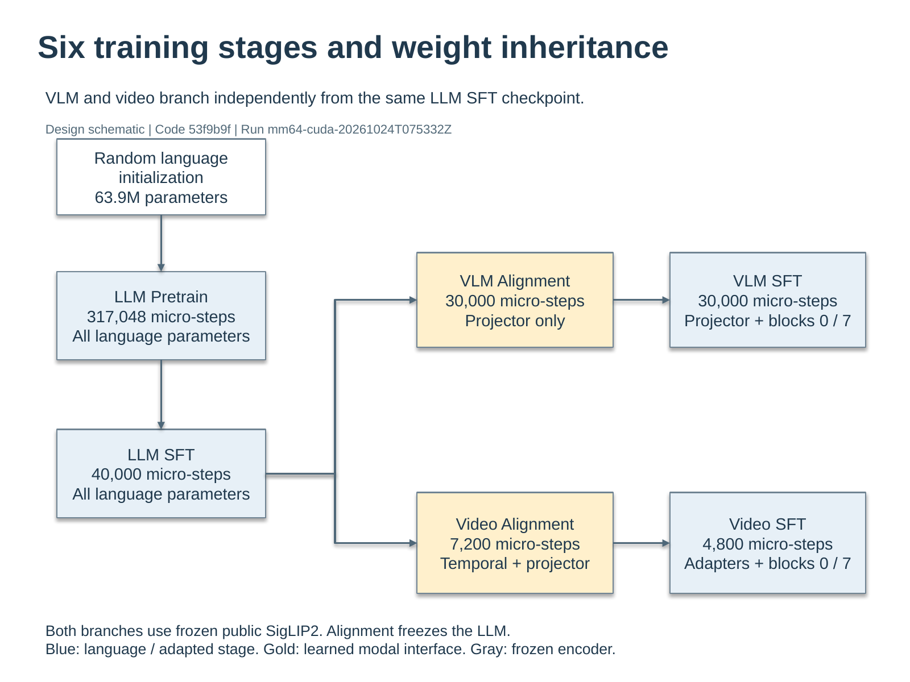
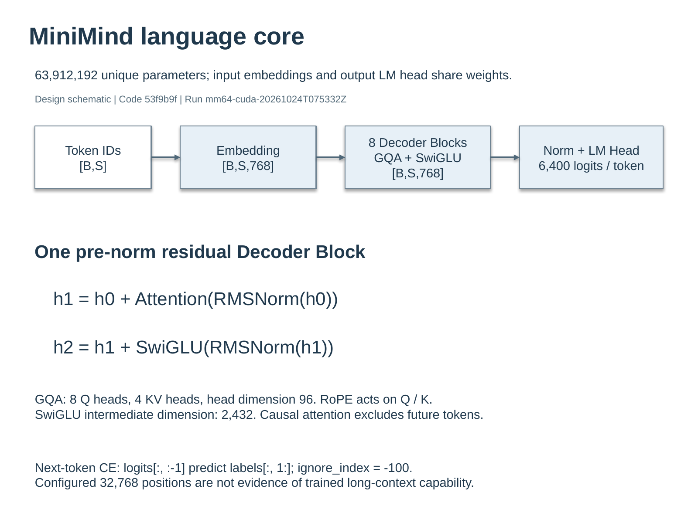
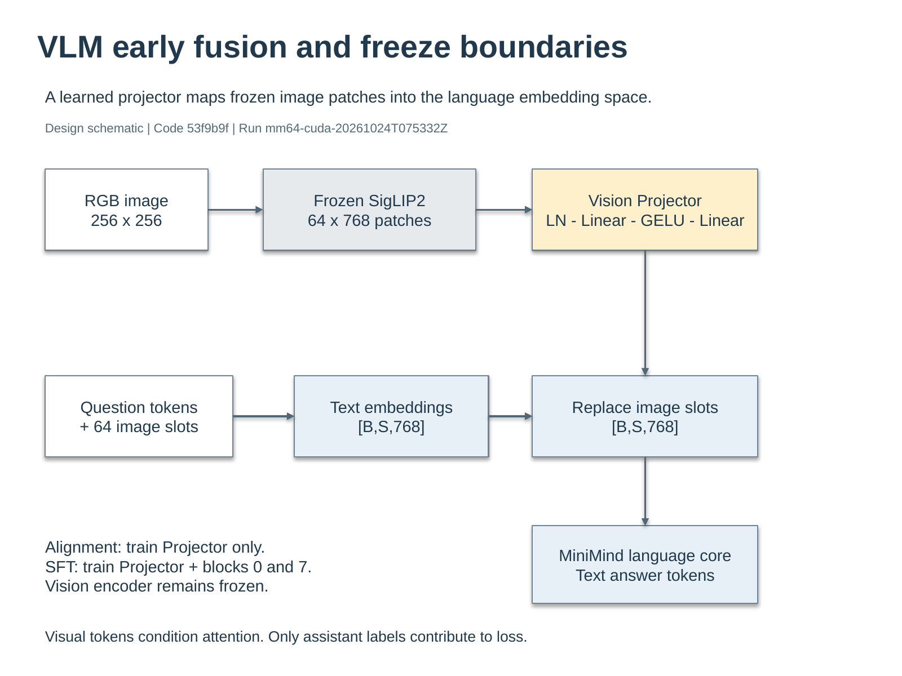
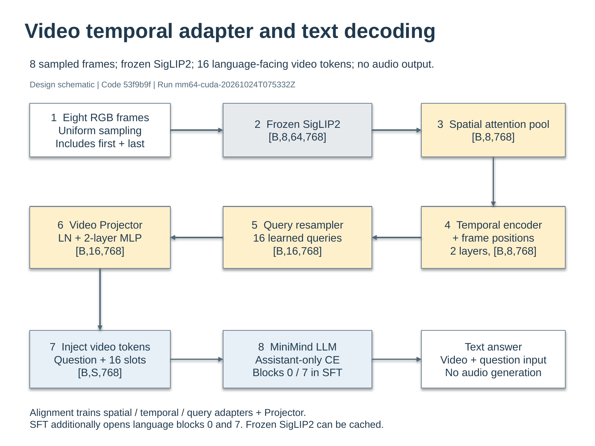

# MiniMind 架构与训练设计图

本组图是对代码 `53f9b9f46560bee446d1c74e89cac991b71a8053` 的**设计示意**，关联 run
`mm64-cuda-20261024T075332Z`。它们不是运行截图，不证明训练完成或模型已获得相应能力。
用户最新要求已取消 DOCX/PPTX 制作与交付，本目录仅提供 PNG 和仓库解读。

## A01 六阶段权重继承与冻结范围

语言主干从随机初始化开始，经 Pretrain 和 SFT 后分叉。VLM Alignment/SFT 与 Video Alignment/SFT
分别沿自己的分支训练，视频模型不继承 VLM SFT。图中数字是配置的 micro-step 预算，
不是 optimizer update 数，也不是当前已完成步数。

两个多模态分支都使用公开预训练且冻结的 SigLIP2。Alignment 冻结语言模型，只训练新增接口；
多模态 SFT 再开放语言模型第 0、7 个 Decoder Block。语言主干并非在这些阶段全参数微调。

## A02 语言模型的数据流与监督

`B` 是 batch 维，`S` 是序列长度。Embedding 把 ID 映射到 768 维，8 个 Decoder Block 整合此前
上下文，再由 Norm 和词表头生成 6,400 维 logits。输入输出共享权重后，独立参数为 63,912,192。

每个 Block 依次加入注意力与 SwiGLU 的残差；GQA 采用 8 个 Q 头、4 个 KV 头，head dimension
为 96，RoPE 用于 Q/K。next-token CE 将 logits 和 labels 错开一位，`-100` 标签不参与计分。
配置允许 32,768 个位置，不等于已经验证长上下文能力。

## A03 图像如何进入语言模型

冻结编码器把 256×256 图像变为 64×768 patch 特征。Projector 经 LayerNorm、两层 Linear 和
GELU 映射特征，替换语言序列中预留的 64 个 image-slot embedding。问题文本沿独立路径形成
embedding，再合入视觉表示。这里不是仅向语言模型附加一个图像标签字符串。

图表示单图路径；双图实现保留图像顺序并使用 128 个位置，见
[VLM 源码](../../../src/minimind_lab/vlm/model.py)。只有 assistant 标签贡献多模态训练 loss，
但问题与图像仍可通过注意力影响回答。

## A04 视频空间与时间信息的处理

按数字顺序阅读：上排从左到右，中排从右到左，下排再从左到右。8 帧经冻结编码器得到
`[B,8,64,768]`，空间注意力池化成每帧一个向量，再加帧位置并经过两层 Temporal Transformer。
16 个可训练 query 重采样为 `[B,16,768]`，Projector 映射后替换问题中的 16 个视频位置。

从 8 个帧向量输出 16 个 query token 是接口重表示，不会凭空增加视频信息。抽帧、空间池化和
压缩都可能丢失细节。存在时间模块只说明架构具备表达顺序的可能，是否实际使用帧序仍需正常/倒序
消融检验。该模型实际范围是视频与问题输入、文本答案输出，没有音频生成。

## 来源与质量记录

来源为固定版本的语言、图像与视频
[模型实现说明](../../../docs/design-implementation.md)以及六阶段 CUDA 配置。
[布局与对象规范](../../../reporting/figures/design-spec.json)记录精确文本、尺寸、色彩和拓扑，
[连接线修复记录](../../../reporting/figures/connector-correction.json)记录了实际预览发现的问题。
文件 SHA-256 与检查摘要见 [figure-manifest.json](figure-manifest.json)。

图从独立的 PowerPoint 原生对象工作副本渲染，使用文件式 OOXML 后端，非 Office.js 实时连接。
预览渲染器为 LibreOffice/Poppler，不把这些 PNG 称为 PowerPoint 应用界面截图。原编辑源包含
71 个原生对象，其中 27 个模块框、21 个文本框、23 条附着连接线，没有嵌入图片、表格或图表。
已逐图核对文字、箭头方向、边界和可读性；最终结构审计均无 hard failure 或 warning。

初次结构审计未发现左右连接端口反向的问题，真实预览却显示线条穿字；只修正四条有问题的连接线，
随后重新渲染确认，并对后续水平端口使用已验证的映射。这说明结构检查不能替代视觉检查。
用户取消文件交付后停止文件制作，既有编辑源仅内部暂存，不作为交付或未来待办。
